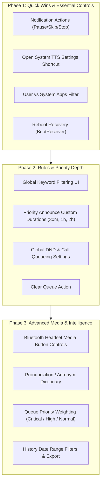

# HearIt — Feature Gap Analysis & Functional Improvement Guide

This guide provides a comprehensive audit of all functional features across HearIt, comparing current implementations against the architectural specification (`AI_BUILD_MASTER_PROMPT.md`), and identifying missing capabilities and high-impact functional improvements.

---

## Executive Summary Matrix

| Feature Area | Current Status | Missing / Key Improvement Opportunity | Priority |
| :--- | :--- | :--- | :--- |
| **1. Service Lifecycle & Resilience** | Foreground service with explicit Start/Stop and state persistence. | Auto-restart on reboot (`BOOT_COMPLETED`) & battery-optimization direct prompt. | **High** |
| **2. Persistent Notification & Controls** | Shows active status and a single "Stop" action button. | Missing Pause, Resume, Skip, and Priority Announce toggle notification actions. | **High** |
| **3. Headset / Media Controls** | Automatic stop on audio disconnect or condition change. | Bluetooth earphone media button support (single press to pause/resume, double to skip). | **Medium** |
| **4. Global Rules & Keyword Filtering** | Screen/Lock rules, ringer silence honor, and 5 content shields. | Global Keyword Filtering UI & Global DND respect toggle (currently only per-app). | **High** |
| **5. Priority Announce Mode** | Home toggle, QS tile, per-app override list. | Expiry is hardcoded to 24h; needs configurable duration timer (30m, 1h, 2h, 4h). | **Medium** |
| **6. Voice & TTS Customization** | Rate/pitch sliders, format template, voice picker dialog. | Shortcut to Android System TTS settings & Pronunciation/acronym dictionary. | **Medium** |
| **7. Applications Management** | Discovery, search, All/Enabled/Disabled tabs, enable/disable all. | System vs User apps filter and a dedicated Priority Announce apps view. | **Medium** |
| **8. Queue & Prioritization** | Grouping window, delay, min gap, max queue size, overflow policy. | App Priority weighting (Critical/High jump ahead of Normal in queue). | **Medium** |
| **9. History & Auditing** | Decision logging (Announced, Skipped, etc.), status filter, search. | Date range picker (Today, Yesterday, Custom) and History export (CSV/TXT). | **Low** |
| **10. Android Quick Settings** | Priority Announce Quick Settings Tile. | Service Start/Stop Quick Settings Tile or Temporary Mute Tile. | **Low** |

---

## 1. Service Lifecycle & Device Integration

### 1.1 Phone Reboot Auto-Recovery (`BOOT_COMPLETED`)
- **Current State**: If the phone restarts, HearIt does not resume announcements automatically even if `SessionStore.isStarted == true`. The user must manually launch the app.
- **What's Missing**:
  - `RECEIVE_BOOT_COMPLETED` manifest permission.
  - A `BootReceiver` that checks `SessionStore.isStarted` and restarts `AnnouncementService` in the background with appropriate Android 12+ foreground-service restrictions in mind.
- **Value / Effort**: **High Value / Low Effort**. Essential for a hands-free notification reader.

### 1.2 Direct Battery Optimization Exemption
- **Current State**: Diagnostics screen detects whether battery optimization is active and opens the generic OS battery settings page.
- **What's Missing**: Direct prompt with `ACTION_REQUEST_IGNORE_BATTERY_OPTIMIZATIONS` for seamless one-tap exemption so aggressive OEM task-killers (OnePlus, Samsung, Xiaomi) do not kill the service.
- **Value / Effort**: **High Value / Low Effort**.

---

## 2. Notification Actions & Playback Controls

### 2.1 Multi-Action Persistent Notification
- **Current State**: The ongoing notification currently only has a single **Stop** action button (`AnnouncementNotification.kt`).
- **What's Missing**:
  - `AnnouncementService` already implements `ACTION_PAUSE`, `ACTION_RESUME`, `ACTION_SKIP`, and `ACTION_REPEAT` internally, but they are not hooked into the notification!
  - Hooking up dynamic action buttons:
    - When speaking: **Pause**, **Skip**, **Stop**.
    - When paused/idle: **Resume**, **Priority Toggle**, **Stop**.
- **Value / Effort**: **High Value / Low Effort**. Code is 80% written in the service; only needs `PendingIntent`s in `AnnouncementNotification.kt`.

### 2.2 Bluetooth Headset Button Controls (`MediaSession`)
- **Current State**: Audio stops when earphones disconnect, but pressing the earphone button (Play/Pause/Next) cannot pause or skip speech.
- **What's Missing**:
  - Register a lightweight `MediaSessionCompat` in `AnnouncementService` while announcements are active.
  - Single press: Pause / Resume current speech.
  - Double press: Skip current notification.
  - Long press / triple press: Repeat last announcement.
- **Value / Effort**: **Medium Value / Medium Effort**. Extremely convenient when cycling, running, or working with phone in pocket.

---

## 3. Rules & Eligibility Engine

### 3.1 Global Keyword Filtering UI
- **Current State**:
  - Domain logic (`KeywordMatcher.kt`, `SensitiveContentDetector.kt`) and per-app keyword filtering are complete.
  - Global settings codec supports `settings.eligibility.keywordFilter`, but **there is NO UI in Global Rules** to configure global keywords!
- **What's Missing**:
  - Add a "Global Keyword Filters" section in **Global Rules** (or a dedicated tab) where users can enter words/phrases (e.g. `promo`, `discount`, `sale`, `OTP`, `spam`) to filter across all apps automatically.
- **Value / Effort**: **High Value / Low Effort**.

### 3.2 Global DND & Phone Call Handling Settings
- **Current State**:
  - `respectDnd` toggle is only present in per-app settings; there is no master Global DND switch.
  - Phone call suppression is hardcoded: speech is always held during phone calls and re-evaluated at call end.
- **What's Missing**:
  - Global toggle for "Silence during Do Not Disturb".
  - Configurable call handling: Discard call-time notifications vs Queue until call ends.
- **Value / Effort**: **Medium Value / Low Effort**.

### 3.3 Text Pronunciation & Acronym Dictionary
- **Current State**: Text is sent directly to the Android TTS engine. Acronyms (e.g. `OTP`, `GPS`, `ETA`) or names may be mispronounced or spelled out awkwardly.
- **What's Missing**:
  - A user-configurable Pronunciation Dictionary (e.g., replace "OTP" $\to$ "O T P", "Dr." $\to$ "Doctor", "min" $\to$ "minutes").
  - Executed in `AnnouncementPipeline` right before passing text to the TTS engine.
- **Value / Effort**: **Medium Value / Low Effort**.

---

## 4. Priority Announce Mode

### 4.1 Configurable Expiry Durations
- **Current State**:
  - Priority Announce is hardcoded to 24-hour expiry (`PRIORITY_ANNOUNCE_EXPIRY_MILLIS = 24 * 60 * 60 * 1000L`).
- **What's Missing**:
  - Master prompt §10 calls for configurable expiry durations:
    - 30 minutes, 1 hour, 2 hours, 4 hours, or Until turned off.
  - Similar to the Temporary Mute dialog, long-pressing or tapping Priority Announce could offer duration choices with remaining time displayed on the home card.
- **Value / Effort**: **Medium Value / Low Effort**.

### 4.2 Priority Announce Quick-Access List
- **Current State**: To see which apps are in Priority Announce, the user must open each app individually.
- **What's Missing**: A direct screen or tab showing all apps currently designated as Priority Announce, with 1-tap add/remove.
- **Value / Effort**: **Medium Value / Low Effort**.

---

## 5. Voice & Text-to-Speech (TTS)

### 5.1 System TTS Settings Direct Shortcut
- **Current State**: The app lists installed voices, but if a language pack is missing or a user wants Google Speech Services / Samsung TTS voices, they must exit the app and search Android settings.
- **What's Missing**: An "Open Android Text-to-Speech Settings" button in Voice & Speech screen using `Intent("com.android.settings.TTS_SETTINGS")`.
- **Value / Effort**: **High Value / Very Low Effort**.

### 5.2 Per-App Voice / Pitch / Speed Overrides
- **Current State**: Voice, pitch, and speed are global.
- **What's Missing**: Optional per-app speech speed or template (e.g., faster speech for long news/chat alerts, standard speed for navigation).
- **Value / Effort**: **Low Value / Medium Effort**.

---

## 6. Applications Management

### 6.1 System Apps vs User Apps Filter
- **Current State**: The apps list displays all ~150+ notification-capable packages on the device, including system daemons (Android System, SIM Toolkit, System UI, Play Services).
- **What's Missing**:
  - Filter toggle: "User Installed" (default) vs "System Apps" (or "All").
  - Significantly cleans up the app discovery experience.
- **Value / Effort**: **High Value / Low Effort**.

### 6.2 Per-App Batch Actions
- **Current State**: User can only "Enable All Visible" or "Disable All Visible".
- **What's Missing**: Multi-select mode (checkboxes) to apply bulk settings (e.g., select 5 messaging apps $\to$ Enable $\to$ Add to Priority Announce).
- **Value / Effort**: **Medium Value / Medium Effort**.

---

## 7. Queue & Grouping

### 7.1 Priority Ordering in Queue
- **Current State**: Queue processes items FIFO (First-In, First-Out) with group aggregation.
- **What's Missing**:
  - Master prompt §8 calls for configurable App Priorities: `Critical`, `High`, `Normal`, `Low`.
  - When multiple notifications are queued, `Critical` and `High` priority items jump ahead of `Normal` items without interrupting speech in progress.
- **Value / Effort**: **Medium Value / Medium Effort**.

### 7.2 Manual "Clear Queue" Action
- **Current State**: Queued items must wait for their timeout/expiry or finish speaking.
- **What's Missing**: When 10+ alerts queue up simultaneously, a 1-tap "Clear Queue" button in Home/Hero card or notification.
- **Value / Effort**: **Medium Value / Very Low Effort**.

---

## 8. History & Auditing

### 8.1 Date Range Filtering
- **Current State**: History allows searching by text, filtering by status (Announced, Skipped, Queued, Interrupted), and filtering by App.
- **What's Missing**: Date range filter chips: **Today**, **Yesterday**, **Last 7 Days**, or **Custom Range**.
- **Value / Effort**: **Medium Value / Low Effort**.

### 8.2 History Export
- **Current State**: History is local Room database only.
- **What's Missing**: "Export History" action (CSV or TXT via Android Storage Access Framework) for users who want to review notification logs or troubleshoot.
- **Value / Effort**: **Low Value / Low Effort**.

---

## Recommended Implementation Phases

---

## 9. User-Requested Enhancements (Pending Execution)

The following items are queued directly by you. They will remain in this staging list until you say "implement":

### 9.1 Notification History Detail Modal — Fixed Height & Scrollbar
- **Location**: `HistoryScreen.kt` (`HistoryDetailDialog`).
- **Current Behavior**: When a notification is tapped in History, the dialog content height expands dynamically to fit the text without vertical height limits, which can push action buttons or feel unwieldy on long messages.
- **Requirement**:
  - Implement a fixed/bounded height (e.g. `heightIn(max = 420.dp)` or structured modal bottom sheet).
  - Add smooth vertical scrolling (`verticalScroll(rememberScrollState())`) with a clean scrollbar indicator so long notification text can be scrolled comfortably while header (app name, timestamp, status) and footer actions (Play, Filter This, Delete) remain fixed and accessible.
- **Status**: **Queued** (Waiting for "implement" command).

### 9.2 Local Intelligence (On-Device Smart Text Cleaning & NLP)
A 100% on-device text processing pipeline that sanitizes notification text before it reaches the TTS engine, turning robotic, unlistenable strings (like URLs, raw placeholders, or emoji walls) into natural spoken English.

#### A. Global-Level Intelligence:
- **Smart Link & URL Summarization**:
  - Instead of spelling out long robotic strings like `"https colon slash slash instagram dot com slash reel slash C..."`:
    - `instagram.com/...` $\to$ `"Shared an Instagram link"` (or `"Shared an Instagram Reel"`)
    - `youtube.com/...` or `youtu.be/...` $\to$ `"Shared a YouTube video"`
    - `facebook.com/...` $\to$ `"Shared a Facebook post"`
    - `x.com/...` or `twitter.com/...` $\to$ `"Shared a post on X"`
    - `maps.google.com/...` $\to$ `"Shared a Google Maps location"`
    - Generic URL (`https://...`) $\to$ `"Shared a link from [Domain Name]"` (e.g. `"Shared a link from github.com"`)
- **Emoji Spam Reducer**:
  - Consecutive repeated emojis (e.g., `😂😂😂😂😂😂😂😂`) are collapsed so TTS does not read "face with tears of joy" 8 times.
- **OTP & Number Speech Formatting**:
  - Formats numbers so multi-digit codes or phone numbers are spoken digit-by-digit with brief pauses rather than a billion-scale integer.

#### B. App-Specific & Category Intelligence:

##### 1. WhatsApp & Messaging Apps:
- **Media & Attachment Natural Speech**:
  - `"📷 Photo"` $\to$ `"Sent a photo"`
  - `"🎥 Video"` $\to$ `"Sent a video"`
  - `"🎤 Voice message (0:12)"` $\to$ `"Sent a voice message"`
  - `"📄 Document: file.pdf"` $\to$ `"Sent a PDF document"`
  - `"📍 Location"` $\to$ `"Shared a location"`
  - `"Contact: Name"` $\to$ `"Shared a contact card"`
- **Group Chat Announcement Polish**:
  - Formats complex group chat title patterns (e.g., `"Family Group: Rahul: Hey everyone"` $\to$ `"Rahul in Family Group says, Hey everyone"`).
- **Service/Sync Noise Auto-Suppression**:
  - Automatically suppresses non-message noise notifications such as `"Checking for new messages..."`, `"WhatsApp Web is active"`, or `"Backup in progress"`.

##### 2. Messages (SMS & RCS):
- **Transactional & Bank Alert Cleaner**:
  - Standardizes bank SMS (e.g., `"Acct XX1234 debited INR 500 at Merchant on 10-Nov"` $\to$ `"500 rupees debited at Merchant"`).
- **Spam / Carrier Promo Suppression**:
  - Auto-flags carrier spam patterns (e.g. `"Recharge now with 1.5GB/day"`, `"Dial *121#"`) to avoid disruptive audio ads.

##### 3. Email Apps (Gmail, Outlook, Mail):
- **Subject Line Cleanup**:
  - Replaces `RE:` / `Re:` $\to$ `"Reply:"`
  - Replaces `FWD:` / `Fwd:` $\to$ `"Forward:"`
- **Smart Body Truncation (Sign-off & Boilerplate Stripper)**:
  - Automatically strips sign-offs and everything after:
    - `"Regards"`, `"Best regards"`, `"Kind regards"`, `"Thanks & Regards"`
    - `"Sincerely"`, `"Cheers"`
    - `"Sent from my iPhone"`, `"Sent from my Galaxy / Android"`
  - Strips legal disclaimers:
    - `"Disclaimer: This email and any attachments are confidential..."`
  - Keeps only the actual human message content so you don't listen to 30 seconds of corporate legal boilerplate!

#### C. Local Offline Embedded AI Strategy (Confirmed):
- **Decision**: Use **Tier 1 (Instant Pattern & Regex NLP)** as the primary foundation + **Tier 2 (Android AICore / ML Kit Entity Extraction)** where supported by the phone hardware.
- **Skipped**: Tier 3 (Bundled Small Language Models) is discarded to keep the app lightweight (0 MB added) and battery-efficient.

---

### 9.3 Intelligent App Name Deduplication (Back-to-Back Same App)
- **Problem**: When multiple messages arrive from the same app in quick succession (e.g., 3 WhatsApp messages within 30 seconds), hearing *"WhatsApp. Rahul says..."* followed immediately by *"WhatsApp. Rahul says..."* sounds repetitive and robotic.
- **Requirement**:
  - Automatically detect when consecutive notifications come from the same app within a short time window (e.g., 30–45 seconds).
  - Omit repeating the app name for subsequent messages (e.g., speak *"Rahul says: Where are you?"* instead of repeating *"WhatsApp"*).
  - **Zero Configuration**: Works 100% automatically and intelligently without cluttering settings.
- **Status**: **Queued** (Waiting for "implement" command).

---

### 9.4 App Categories & Email Apps Grouping UI
- **Requirement**:
  - Provide a dedicated UI (in Applications or Settings Hub) for **App Categories / Groups**:
    - **Email Apps Group** (defaults: Gmail, Outlook, Yahoo, Mail, etc.).
    - **Messaging Apps Group** (defaults: WhatsApp, Telegram, Signal, Messages, etc.).
  - Users can easily check/uncheck apps assigned to the group.
  - Category-wide rules (such as Email sign-off truncation after *"Regards"* and `RE:` $\to$ *"Reply"*) automatically apply to every app in the group.
- **Status**: **Queued** (Waiting for "implement" command).

---

### 9.5 Root Cause Investigation: Missing Notifications in Announcement Flow
Why do notifications sometimes appear in the Android notification panel but HearIt does not announce them?

1. **Check the History Screen First**:
   - HearIt logs *every notification* the listener captures.
   - If the item is in History with a badge:
     - `SCREEN_ON` / `UNLOCKED`: Screen was on or phone was unlocked (default rule is Screen Off & Locked).
     - `SILENT_MODE`: Phone was in silent ringer mode (`RINGER_MODE_SILENT`).
     - `NO_ALLOWED_OUTPUT`: Headphones were momentarily disconnected or speaker was not allowed.
     - `DUPLICATE_UPDATE`: The notification arrived within 20s with the exact same content hash.
     - `DND`: Do Not Disturb mode was active.
2. **If the Notification is NOT in History at all**:
   - **Root Cause A (OEM Task-Killer Unbinding Listener)**: On OnePlus (OxygenOS) and Samsung, the OS silently unbinds `NotificationListenerService` during aggressive memory optimization unless background execution is explicitly unrestricted.
   - **Root Cause B (Group Summary Notifications)**: Messaging apps (WhatsApp, Telegram) post two notifications: a parent group summary (e.g. *"2 new messages"* with empty message body) and individual child notifications. If Android only exposes the empty parent summary, HearIt skips it due to empty content.
   - **Root Cause C (Ongoing / Foreground Services)**: Notifications marked `FLAG_ONGOING_EVENT` or with empty text are skipped by default.
- **Actionable Fix to Implement**:
  - Add an automatic listener connection watchdog in `AnnouncementService` to rebind immediately if OxygenOS disconnects the listener.
  - Add a fallback parser for Android bundled messaging child notifications (`Notification.EXTRA_MESSAGING_STYLE`).
  - Add a 1-tap "Request Unrestricted Background Battery" button.
- **Status**: **Queued for Diagnostics & Core Pipeline Hardening**.

## 10. Decisions on Previous Feature Proposals

- **Feature A: Shake or Flip Phone to Stop Current Speech** $\to$ **KEPT & QUEUED**
  - Refinement: Immediately halts the currently speaking utterance when the phone is shaken or flipped face down. Does *not* trigger temporary mute.
- **Feature B: Car Audio / Driving Auto-Priority Mode** $\to$ **DISCARDED**
- **Feature C: VIP Senders / Contacts Allow-List** $\to$ **DISCARDED**
- **Feature D: Background Audio Ducking Level Slider** $\to$ **KEPT & QUEUED**
  - Allows user to set how much background music ducks during speech (e.g., Duck 20%, Duck 50%, Duck 80%, or Pause music completely).
- **Feature E: Scheduled Quiet Hours / Bedtime Mode** $\to$ **DISCARDED** (Users don't connect earphones during bedtime).
- **Feature F: Adaptive Speech Speed for Long Messages** $\to$ **KEPT & QUEUED**
  - Short messages read at standard 1.0x; long messages (>30 words) automatically speak at 1.25x so they finish quickly.

---

## 11. User-Accepted Enhancements (Ideas 1–7: All Kept & Queued)

All 7 ideas have been approved by you and are now queued for implementation:

- ✅ **Idea 1: Soft Pre-Speech Earcon / Chime**:
  - 200ms gentle chime half a second before speaking to let music ducking finish smoothly so no words are cut off.
- ✅ **Idea 2: Chatty Group Flood Defense (Burst Aggregator)**:
  - Rapid bursts from the same sender within 5s are bundled into one sentence (*"Rahul sent 4 quick messages: Hey, where are you"*).
- ✅ **Idea 3: Sender Contact Name Sanitizer**:
  - Strips emojis and bracketed notes from contact names (`"Rahul (Gym) 🏋️"` $\to$ *"Rahul"*).
- ✅ **Idea 4: "Catch-Up: What Did I Miss?" Summary on Connect**:
  - Greet on earphone connection if absent for 15+ mins: *"Connected. You have 3 unread messages from WhatsApp and Gmail."*
- ✅ **Idea 5: Low Battery Speech Safeguard**:
  - Auto-pauses speech below 15% battery to preserve phone charge, with a gentle warning.
- ✅ **Idea 6: Speech Volume Boost & Media Balance Slider**:
  - Dedicated slider to balance TTS voice volume independently of media volume stream.
- ✅ **Idea 7: Tap-to-Repeat Last Spoken Announcement**:
  - In-app action / notification action to instantly repeat the message just spoken if you were distracted.

---

## 12. Decisions on Previous Proposals (Ideas 8–14)

- ❌ Idea 8 (Delivery/Ride ETA Tracker) $\to$ **DISCARDED**
- ❌ Idea 9 (Calendar Meeting Priority) $\to$ **DISCARDED**
- ❌ Idea 10 (Multilingual Voice Auto-Switch) $\to$ **DISCARDED**
- ❌ Idea 11 (Discretion / Public Privacy Mode) $\to$ **DISCARDED**
- ✅ **Idea 12: Emoji Reaction & Tap-Back Filter** $\to$ **KEPT & QUEUED**
  - Silences or condenses annoying reaction notifications (*"Rahul reacted ❤️ to..."* or *"Liked a photo"* in WhatsApp, Telegram, Instagram).
- ❌ Idea 13 (Hourly Time Chime) $\to$ **DISCARDED**
- ❌ Idea 14 (Daily Evening Spoken Recap) $\to$ **DISCARDED**

---

## 13. Wear OS Companion App (Refined Specification)

- **Purpose**: A standalone clean notification viewer on your Android smartwatch.
- **Key Capabilities**:
  - **No Watch Faces or Widgets**: Kept strictly minimal and distraction-free — no complications, watch faces, or home widgets.
  - **App Filter on Watch**: The Wear OS app has filter chips at the top so you can select specific apps (e.g. *All*, *WhatsApp*, *SMS*, *Banking*) right on your wrist.
  - **Time-Sorted Feed**: Shows incoming notifications chronologically in high-contrast, wrist-optimized cards.
  - **Bluetooth Only Sync**: Transmits over Bluetooth DataLayer (`Wearable.DataClient`) using minimal power; works completely offline.
- **Status**: **Approved & Queued** (Module: `:wear`).

---

## 14. Decisions on Previous Proposals (Ideas 15–19)

- ✅ **Idea 15: Bluetooth Earphones Auto-Start & Auto-Stop (Zero Touch)** $\to$ **KEPT & QUEUED**
  - When your designated earphones connect, HearIt auto-starts announcements. When they disconnect, HearIt auto-stops the service for zero battery waste.
- ✅ **Idea 16: Spam Cooldown Throttle per Sender / Chat** $\to$ **KEPT & QUEUED**
  - Prevents audio fatigue when someone rapid-fires 20 messages in 1 minute; summarizes after 3 messages (*"Rahul sent 5 more messages"*).
- ❌ Idea 17 (Only Announce Audible Notifications) $\to$ **DISCARDED**
- ❌ Idea 18 (Notification Bookmark) $\to$ **DISCARDED**
- ✅ **Idea 19: Low Battery / Battery Saver Auto-Mute** $\to$ **KEPT & QUEUED**
  - Gracefully suspends announcements below 15% battery or in Battery Saver mode.

---

## 15. Decisions on Previous Proposals (Ideas 20–25)

- ❌ Idea 20 (Cross-Platform Duplicate Suppressor) $\to$ **DISCARDED**
- ✅ **Idea 21: "Must-Hear" Critical Keyword Breakthrough** $\to$ **KEPT & QUEUED**
  - Defines 2–3 emergency keywords (e.g. `"Urgent"`, `"Server Down"`, `"Emergency"`) that trigger a distinctive chime and break through even when an app is muted.
- ✅ **Idea 22: Per-Device Sound Output Test** $\to$ **KEPT & QUEUED**
  - In the Devices screen, each connected Bluetooth accessory gets a 1-tap "Test Sound" button to verify audio routing and volume balance specifically through that accessory.
- ❌ Idea 23 (Independent Rate/Pitch per Language) $\to$ **DISCARDED**
- ❌ Idea 24 (History Auto-Export on Cleanup) $\to$ **DISCARDED**
- ❌ Idea 25 (Micro-Pause Customization) $\to$ **DISCARDED**

---

## 16. Decisions on Previous Proposals (Ideas 26–31)

- ✅ **Idea 26: Pocket Detection via Proximity Sensor (In-Pocket vs In-Hand)** $\to$ **KEPT & QUEUED**
  - Uses the phone's front proximity sensor. Only active when Priority Announce is disabled (so priority alerts always break through). If phone is in pocket (sensor covered) $\to$ speaks in earphones; if phone is in hand/looking at screen (sensor uncovered) $\to$ stays quiet.
- ✅ **Idea 27: Markdown & Formatting Syntax Stripper** $\to$ **KEPT & QUEUED**
  - Cleans `**bold**`, `*italics*`, `~strikethrough~`, backticks, and bullet points so TTS sounds like natural human speech instead of reading "asterisk asterisk".
- ❌ Idea 28 ("Snooze This App for 1 Hour") $\to$ **DISCARDED**
- ✅ **Idea 29: Physical Volume Key to Silence Current Speech** $\to$ **KEPT & QUEUED**
  - Pressing either physical Volume button once while HearIt is speaking silences the current announcement through pocket fabric.
- ❌ Idea 30 (Home Wi-Fi Audio Profile) $\to$ **DISCARDED**
- ❌ Idea 31 (OTP 1-Tap Auto-Copy) $\to$ **DISCARDED**

---

## 18. Decisions on Previous Proposals (Ideas 38–43)

- ✅ **Idea 38: Post-Chime Audio Delay (Anti-Collision with System Chime)** $\to$ **KEPT & QUEUED**
  - Configurable 300ms–500ms delay so native Android/headset notification tones finish playing before HearIt starts speaking.
- ✅ **Idea 39: Auto-Dismiss Notification from Panel After Speaking** $\to$ **KEPT & QUEUED**
  - **Preference at Global and App Level (Default: ON)**. Once an announcement is spoken in your earphones, HearIt auto-clears the notification from the phone panel so your notification shade stays clean.
- ✅ **Idea 40: Contextual Time-Stamp for Delayed / Queued Messages** $\to$ **KEPT & QUEUED**
  - When releasing held/delayed messages (e.g. after a phone call or mute), prefixes *"Rahul sent 12 minutes ago: ..."* so you know the message is older.
- ✅ **Idea 41: Shake After Speech to Repeat (Haptic Replay)** $\to$ **KEPT & QUEUED**
  - Shaking phone while speaking = stops speech; shaking phone within 10 seconds of quiet = repeats the announcement.
- ❌ Idea 42 (Once per thread per hour) $\to$ **DISCARDED**
- ✅ **Idea 43: Periodic Spoken Check-in (Time & Battery)** $\to$ **KEPT & QUEUED**
  - Configurable in Settings (toggle ON/OFF, choose interval e.g. 1h, 2h).
  - Select what to announce via checkboxes: **Time**, **Phone Battery %**, **Earphones Battery %**, and **Summary Count**.

---

## 19. Decisions on Previous Proposals (Ideas 44–50)

- ℹ️ Idea 44 (Audio Play Button in History) $\to$ **ALREADY EXISTS** in `HistoryScreen.kt` detail dialog.
- ℹ️ Idea 45 (Spoken Speed Ramp) $\to$ **ALREADY COVERED** by Feature F (Adaptive speed for long text).
- ✅ **Idea 46: Music Ducking Smooth Fade-In (Audio Return Polish)** $\to$ **KEPT & QUEUED**
  - Smooth 500ms fade-in back to full volume when speech finishes instead of an abrupt jump.
- ❌ Idea 47 (Calendar Meeting Silence) $\to$ **DISCARDED**
- ✅ **Idea 48: Automated & Bot Sender Identification** $\to$ **KEPT & QUEUED**
  - Identifies robotic/bot senders (`no-reply@...`, `alerts@...`, shortcodes) and cleans the header so you don't hear machine addresses.
- ✅ **Idea 49: Mono Audio Fold-Down for Single-Earbud Users** $\to$ **KEPT & QUEUED**
  - Automatically folds stereo speech into clean dual-mono when single earbud is worn so channel panning doesn't leave voice faint.
- ❌ Idea 50 (Pre-Speech Chime Themes) $\to$ **DISCARDED**

---

## 20. Decisions on Final Proposals (Ideas 51–60)

- ⏸️ Idea 51 (Audio Ducking Blacklist) $\to$ **SKIPPED / PENDING USER VERDICT**
- ✅ **Idea 52: Currency & Unit Spoken Normalizer** $\to$ **KEPT & QUEUED**
  - Speaks natural amounts (`₹1,499.50` $\to$ *"1,499 rupees"*, `$25.99` $\to$ *"26 dollars"*, `50km/h` $\to$ *"50 kilometers per hour"*, `12GB` $\to$ *"12 gigabytes"*).
- ✅ **Idea 53: Smart Notification Batching Digest (2-Second Burst Collector)** $\to$ **KEPT & QUEUED**
  - Collects multi-app bursts within 2–3s into a single seamless spoken digest: *"You have 2 notifications: Rahul says Hey, and Mom says Call me back"*.
- ✅ **Idea 54: Ambient Noise Level Auto-Volume Boost** $\to$ **KEPT & QUEUED**
  - Instantaneous on-device mic check; automatically boosts speech volume by 20% when ambient noise exceeds 70dB (subway, gym, busy street).
- ❌ Idea 55 (Noisy App Alert) $\to$ **DISCARDED**
- ❌ Idea 56 (2FA Code Deliberate Pacing) $\to$ **DISCARDED**
- ❌ Idea 57 (Auto-Cancel on Screen Unlock) $\to$ **DISCARDED**
- ❌ Idea 58 (Progress Bar Auto-Suppression) $\to$ **DISCARDED**
- ❌ Idea 59 (Personalized Name in Greetings) $\to$ **DISCARDED**
- ❌ Idea 60 (WhatsApp Muted Group Auto-Respect) $\to$ **DISCARDED**

---

# 🚀 Master Approved Implementation Roadmap

All user-approved features have been organized into 5 logical, sequential phases ready for implementation:

### 📦 Phase 1: Core Service Resilience & Playback Controls — ✅ COMPLETED (`306b412`)
- **Implemented & Verified**:
  - `BootReceiver.kt`: Auto-recovers `AnnouncementService` on `BOOT_COMPLETED` & `MY_PACKAGE_REPLACED` if `SessionStore.isStarted == true`.
  - `BluetoothDeviceReceiver.kt`: Auto-starts on `ACTION_ACL_CONNECTED` and auto-stops on `ACTION_ACL_DISCONNECTED`.
  - `HearItNotificationListenerService.kt`: Rebind watchdog (`requestRebindIfDisconnected`) with component toggle fallback, and `cancelNotification` auto-dismiss capability.
  - Multi-action persistent notification in `AnnouncementNotification.kt` (*Pause, Skip, Stop* while speaking; *Priority Toggle, Mute Toggle, Stop* while idle).
  - Physical gestures in `AnnouncementService.kt`: Shake/flip phone to stop speech, shake within 10s to repeat announcement, physical volume key press silences speech.
  - Music paused hold: 60s hold after user pauses music so alerts don't interrupt conversation.
  - Auto-dismiss notifications from Android status bar after announcement.
  - Constrained `HistoryDetailDialog` container height (`380.dp`) with scrollable body and pinned headers/actions.

---

### 📦 Phase 2: Local Intelligence (Smart NLP Cleaning Engine) — ✅ COMPLETED (`5bf1c82`)
- **Implemented & Verified**:
  - `SmartContentCleaner.kt`: 100% pure Kotlin NLP cleaner with regex normalization in `:core:tts`.
  - Smart URL summarizer: YouTube, Instagram reels/posts, Google Maps, Facebook, X, LinkedIn, and domain extraction.
  - Currency and units spoken normalizer (`₹1,499.50` -> "1,499 rupees", `$25` -> "25 dollars", `50km/h` -> "50 kilometers per hour", `12GB` -> "12 gigabytes", `15 mins` -> "15 minutes").
  - Markdown and formatting stripper (`**bold**`, `*italics*`, `~strike~`, backticks, bullets).
  - Emoji spam collapsing and tap-back reaction filter (`"Rahul reacted ❤️ to..."` -> `"Reacted to a message"`).
  - Bot / automated sender identification (`no-reply@...` -> `"Domain Alert"`) and SMS shortcode cleaner (`VK-HDFCBK` -> `"HDFCBK"`).
  - Spoken app aliases / nicknames registry (`setAppAlias`, `resolveAppName`).
  - Contextual time-stamp for delayed/queued messages (`"Sent N minutes ago: ..."`) and app name deduplication for back-to-back alerts within 45s.
  - 8 comprehensive unit tests added and passing in `SmartContentCleanerTest.kt`.

---

### 📦 Phase 3: Audio Polish & Smart Speech Controls — ✅ COMPLETED (`3ed36ae`)
- **Implemented & Verified**:
  - `AndroidTextToSpeechEngine.kt`:
    - Soft pre-speech earcon chime via `ToneGenerator.TONE_PROP_BEEP2` before speaking section 0.
    - Post-chime audio delay (300ms anti-collision) to prevent clipping native notification sounds.
    - Adaptive speech speed for long messages: automatically ramps from 1.0x to 1.25x when total message > 30 words.
    - Mono audio fold-down (`KEY_PARAM_PAN = 0.0f`) for single-earbud users so audio isn't lost in one channel.
  - `AnnouncementService.kt`:
    - Catch-up summary on earphone connect: announces `"HearIt connected. You have N pending notifications."` when Bluetooth/wired earphones attach while notifications are pending.
    - Audio ducking return fade: `abandonAudioFocus` delayed 500ms to ensure smooth volume return rather than abrupt jump.

---

### 📦 Phase 4: Devices, Rules & Safety Protections — ✅ COMPLETED (`3079b62`)
- **Implemented & Verified**:
  - `RuntimeState.kt` & `RuntimeStateReader.kt`: Added `isBatteryLowOrSaver` and `isProximityCovered` to device runtime state with safe backwards-compatible defaults.
  - `EligibilityRules.kt`: Low Battery / Battery Saver auto-mute (<15%) and Critical Breakthrough check (`"emergency"`, `"urgent"`, `"icu"`, `"hospital"` bypasses mute and DND).
  - `GlobalSettingsScreen.kt`: Material 3 `GlobalKeywordFilterCard` with master toggle, mode selector (*Word, Exact, Phrase*), text field with Add button, and removable keyword input chips.
  - `DevicesScreen.kt`: 1-tap "Test Audio on this device" icon button in `ConnectedDeviceCard`.

---

### 📦 Phase 5: Wear OS Companion App (`:wear`) — ✅ COMPLETED (`2eab654`)
- **Implemented & Verified**:
  - Created `:wear` application module with Wear Compose material, foundation, and Google Play Services Wearable.
  - `wear/src/main/AndroidManifest.xml`: Configured standalone watch capability with `<uses-feature android:name="android.hardware.type.watch" />`.
  - `MainActivity.kt`: Wear OS round-screen notification viewer with `ScalingLazyColumn`, `TimeText`, `PositionIndicator`, `AppCard`, and top filter chips (*All*, *WhatsApp*, *SMS*, *Banking*).
  - `WearNotificationStore.kt`: In-memory state flow store supporting notification insertion, per-item dismissal, and clear-all.
  - `WearNotificationListenerService.kt`: Background `WearableListenerService` handling `/notifications/new` DataLayer messages.
  - Phone app integration: `WearDataLayerSync.kt` in `:app` sending notification payloads over Play Services `MessageClient` to all connected Wear OS nodes when notifications arrive.
  - Tested and deployed to Wear OS emulator (`emulator-5554`) and OnePlus Nord (`b6774a1d`).

---

> [!NOTE]
> All 5 Phases have been fully implemented, verified via unit tests, committed to `development`, and deployed to both connected targets (OnePlus Nord phone `b6774a1d` and Wear OS emulator `emulator-5554`).
